# Phase 0
**Redaction:** I black out private network addresses, MAC addresses, and any router/account identifiers; I keep non-sensitive usernames, the local hostname `pve01`, and the general network structure visible because they are needed to understand the setup.

### Upload or URL?
- I decided to download the ISO using Proxmox's "Download from URL" option because:
	- Proxmox loads the ISO directly from the official mirror onto the host.
	- I avoid the unnecessary detour via my PC and browser upload, save time and can have the checksum checked directly during the download.
- Upload only if the host is offline, the source has login/captcha/redirects or I use my own ISO image that has already been verified locally.


#### Download Site debian.org:
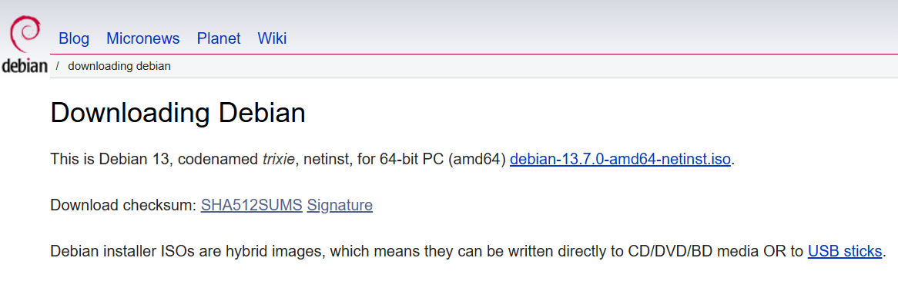

#### Checksum:


---

### Which algorithm is really used?
- SHA256
- Proxmox supports several algorithms for "Download from URL": md5, sha1, sha224, sha256, sha384 and sha512.
- Proxmox VE stores ISO images in the storage’s template/iso/ directory. ([Proxmox VE Documentation](https://pve.proxmox.com/wiki/Storage:_Directory))
- Debian officially provides SHA256/SHA512 checksum files alongside its images and recommends verifying them with the matching checksum tool. ([Debian](https://www.debian.org/CD/verify))
- In Proxmox:
	- Checksum algorithm: SHA256
	- Checksum: the 64-digit hash from the official "SHA256SUMS"
	- URL: direct `iso` address, not the download page
- Debian’s installation documentation describes comparing the ISO’s sha256sum output with the corresponding entry in SHA256SUMS. ([Debian Installation Guide](https://www.debian.org/releases/stable/amd64/ch04s07.en.html))

#### Verification of checksum:
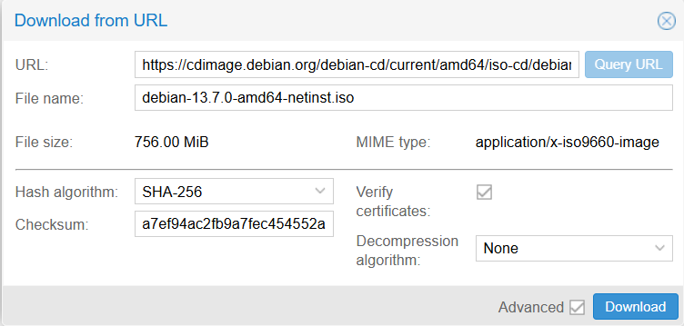

#### Finished ISO download:
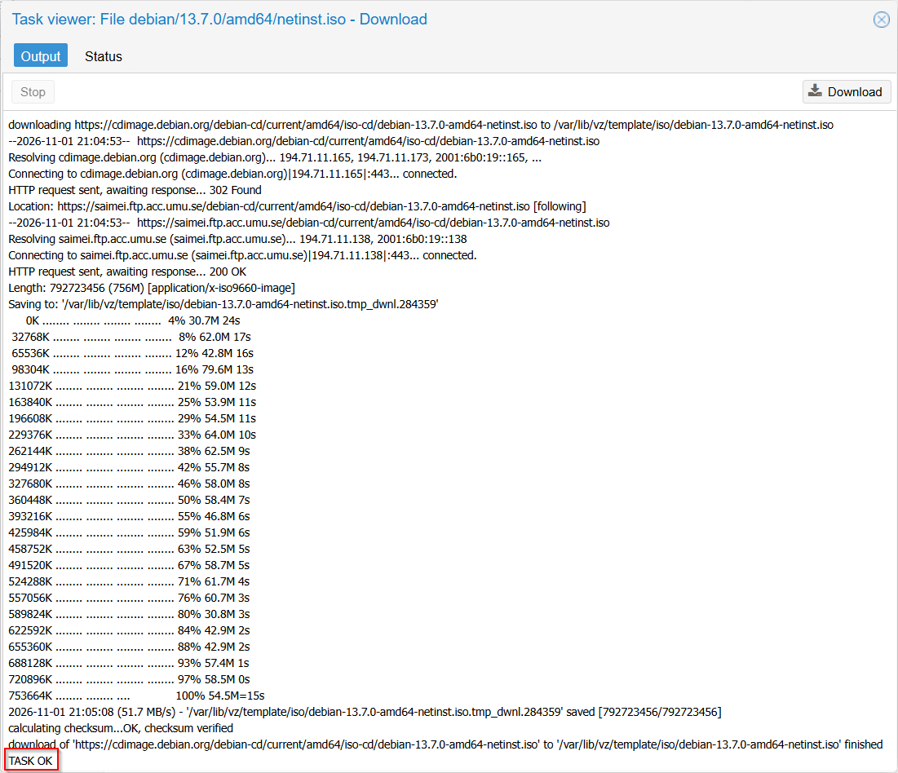

#### Debian ISO image in Proxmox:


---

### Signature check carried out?

- Yes, but not the ISO directly, but the "SHA256SUMS" file.
- Process:

1. Download `SHA256SUMS` and `SHA256SUMS.sign`.
2. Import Debian’s signing key.
3. Compare the imported key’s fingerprint with the fingerprint on Debian’s official verification page.
4. Verify the signature with `gpg --verify SHA256SUMS.sign SHA256SUMS`. ([GnuPG manual](https://www.gnupg.org/documentation/manuals/gnupg26/gpg.1.html))
5. Check the ISO’s SHA-256 value against the signed `SHA256SUMS` file.
6. Enter the confirmed hash in Proxmox.

#### GPG Error:
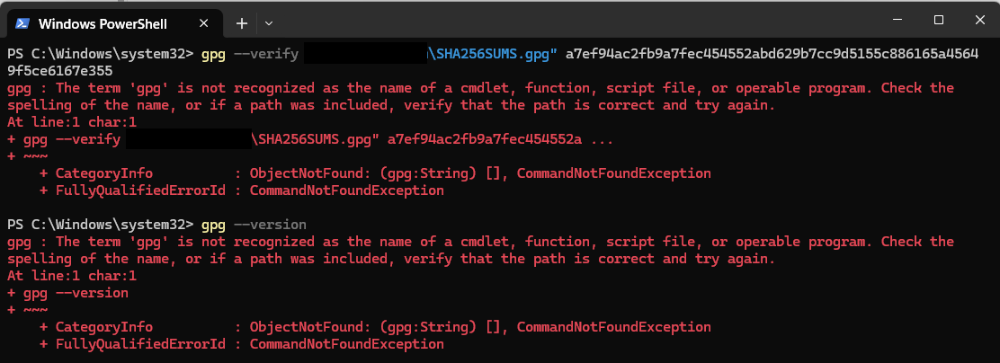

#### After GPG Installation:


#### Bad Signature:


#### GPG Verification Error:


#### Changing to SHA256SUMS:
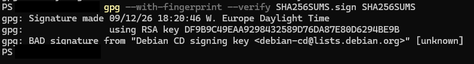

#### Signature check finally worked!!!:


- The primary key fingerprint shown by GPG matches Debian’s official Debian CD signing-key fingerprint (`DF9B 9C49 EAA9 2984 3258 9D76 DA87 E80D 6294 BE9B`) on Debian’s verification page. ([Debian](https://www.debian.org/CD/verify))

### Why does it matter to verify the checksum and what does a signature add on top of the checksum?
- It ensures that the file is both *completely intact* and *authentic*.
- **Checksum (Integrity)**:
	- A string of characters (like SHA256 hash) that acts as a digital fingerprint of the file.
	- If even a single bit of the ISO changes during download, the checksum changes completely.
	- This proves that the download isn't **corrupted or modified**.
- **Signature (Authenticity)**:
	- A cryptographic file (like a `.gpg` or `.asc` file) provided by the developers.
	- It proves the file **actually came from the official authors** (in this example Debian) and hasn't been swapped out by a malicious third-party attacker.
	
---

### Errors, how I fixed it and what I learned from it
- *I passed a SHA-256 hash value to `gpg --verify` instead of the signature and signed file. `gpg --verify` expects a signature file and, for a detached signature, the signed data file—not a checksum string. ([GnuPG manual](https://www.gnupg.org/documentation/manuals/gnupg26/gpg.1.html))*
- *I resolved “gpg is not recognized” by installing Gpg4win, “No public key” by importing Debian’s signing key, and “No such file or directory” by correcting the filenames.*
- *Verification then reported “BAD signature” because I had created the checksum file by copying text from a browser window rather than downloading the original file.*
- *The resulting copy contained Windows-style CRLF line endings and lacked a final newline. Since the signature checks the exact bytes of the signed file, restoring Unix-style LF line endings and the final newline produced “Good signature,” confirming that the restored file matched what Debian signed.*
- *This taught me to preserve signed files exactly as downloaded and treat any “BAD signature” as a verification failure until its cause is established, rather than assuming it is merely a formatting issue.*

---

### Check if Proxmox is inside my home network

#### Proxmox in home network:
- I went into my router configuration interface and checked if my proxmox server is actually in my home network.

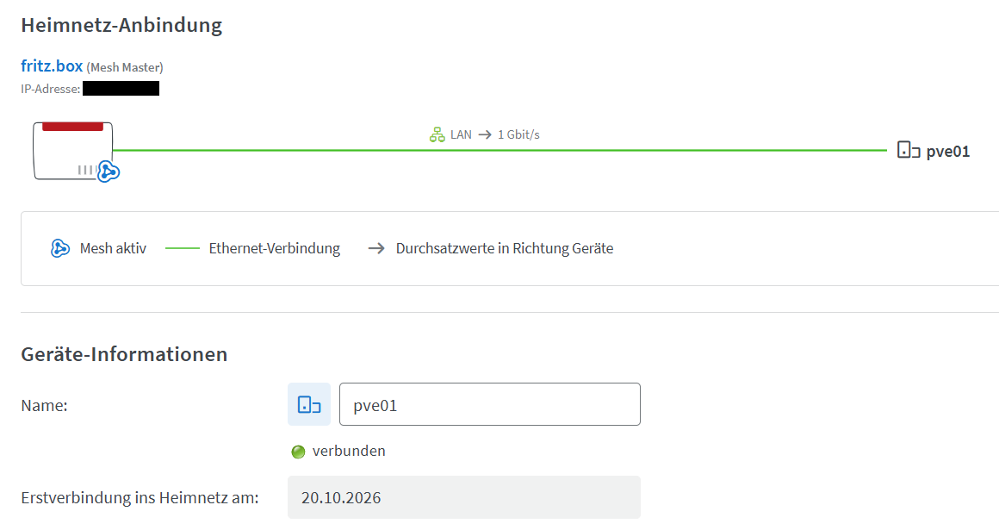

#### IP Settings for Proxmox in home network:
- The checkbox only controls whether the DHCP server keeps assigning the same lease to that device.
- It does not affect an address the device configures itself.
- Since I have set up an static IP address outside the DHCP range for my Proxmox server, it isn't a problem that the box is not checked.

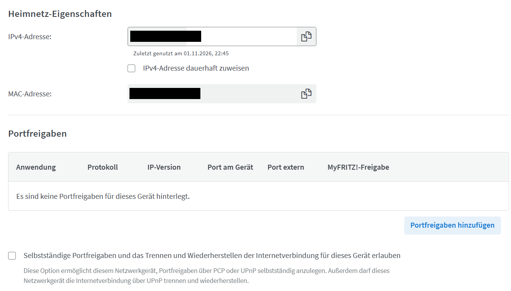

#### Proxmox's fixed IP:
- I made a check on that. Now I had to look if my proxmox server has an static IP address or not.
- The first look was inside the Web UI.

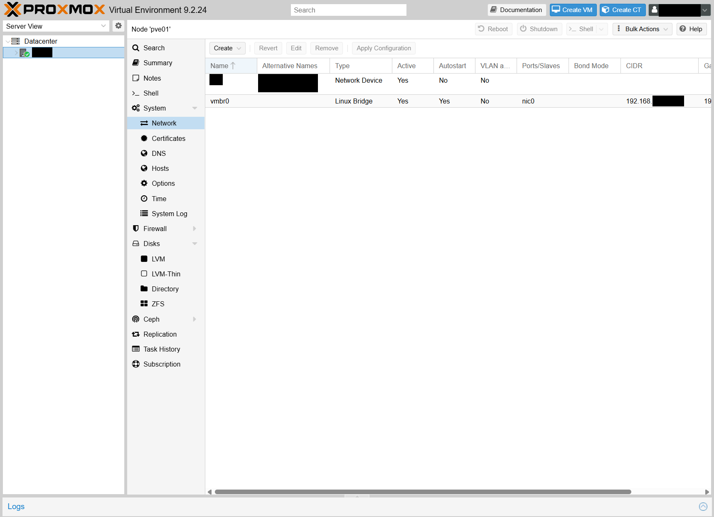

- After that I checked if my proxmox server has an static IP address or if my router gave it an IP-Address through DHCP-Server.

```bash

cat /etc/network/interfaces
```

#### Shell confirmation - Proxmox has static IP:
- This was the outcome:

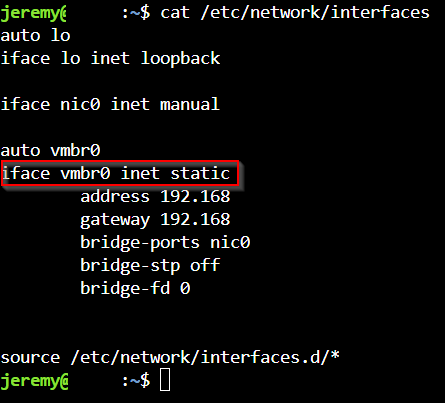

| Components | Usecase |
|------------|---------|
| LENOVO ThinkCentre M920q | Host-machine |
| Proxmox VE v9.2 | Virtualization Software (Serverhost) |
| Debian 13, Codename: *trixie* -> debian-13.7.0-amd64-netinst.iso | VM OS |

## IP-Plan

- I had an overall structure set up, but I needed to find an unused IP address outside the DHCP range.

```bash
sudo nmap -sn -PR 192.168.x.x-x 192.168.x.x-x
```

- `-sn` performs host discovery without a port scan.
- Nmap’s official documentation describes host discovery as “ping scanning.” ([Nmap Network Scanning](https://nmap.org/book/host-discovery-find-ips.html))
- `-PR` uses ARP discovery, which is appropriate for devices on the same local Ethernet network and more reliable here than ordinary ping alone.
- **ARP Discovery** = ***Address Resolution Protocol*** is a network communication protocol that maps an IPv4 address to a physical MAC address *(Media Access Control address)* on a local area network *(LAN)*.

#### Nmap scan:
- This scan shows who is online right now, not which addresses are free.
- It is a useful cross-check, but it doesn’t prove an address is free
- I pinged some IP addresses outside the DHCP range and chose one for the LAMP VM.

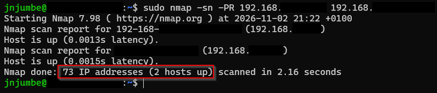

#### Ping selected LAMP IP address:
- I chose one IP address for my LAMP VM and to test if this IP is really not in use I pinged it with:

```bash
ping 192.168.x.x -c 4
```
- `-c 4` tells `ping` to send exactly 4 echo-request packets, not to stop after receiving 4 replies. My screenshot confirms this: 0 echo replies were received, yet `ping` still stopped after transmitting 4 packets.
- The behaviour and options of `ping` are documented in the online `iputils` manual page. ([ping(8) — man7.org](https://man7.org/linux/man-pages/man8/ping.8.html))
- The `Destination Host Unreachable` message was not sent by the target IP. It came from my own host after ARP could not resolve a MAC address for the target, so it indicates that no device answered at that address rather than that the target actively rejected the ping (own conclusion from the observed ARP behaviour).

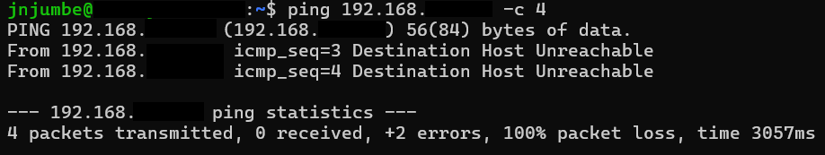

| Device | IP | Static/DHCP | Purpose |
|--------|----|-------------|---------|
| FRITZ!Box | 192.168.x.x | static | Gateway, DHCP .20-.200 |
| sw-buero | 192.168.x.x | DHCP | Managed switch |
| pve01 | 192.168.x.x | static | Proxmox host |
| LAMP VM | 192.168.x.x | static | host+1, so related servers sit next to each other and are easy to find |