# Phase 0 – Preparation

> **Status:** ✅ Done

> **Date:** 2026-11-01 - 2026-11-05

> **Next phase:** [Phase 1 – Base Install](phase-1-base-install.md)

> **Redaction:** In this phase, private network addresses, MAC addresses, usernames and router/account identifiers are blacked out in screenshots and masked as `192.168.x.x` in text. The lab hostname `pve01` and the general network structure stay visible because they are needed to understand the setup. Later phases show private (RFC 1918) addresses where they help to follow the setup.

---

## 1. Goal & Done-when

**Goal:** A verified Debian 13 installer image on the Proxmox host and a conflict-free IP plan as the base for the lab VMs.

- [x] Debian 13 netinst ISO downloaded through Proxmox "Download from URL" with a SHA256 checksum
- [x] Signature of `SHA256SUMS` verified; key fingerprint matches Debian's official page
- [x] Proxmox host confirmed to be in the home network with a static IP outside the DHCP range
- [x] Network switch has a static IP outside the DHCP range and answers ping
- [x] IP for the LAMP VM chosen and verified as unused
- [x] IP plan documented

---

## 2. Starting point

| Component | Use case |
|-----------|----------|
| LENOVO ThinkCentre M920q | Host machine |
| TP-Link TL-SG108E 8-Port Gigabit Switch | Ethernet switch |
| Proxmox VE v9.2 | Virtualization software (server host) |
| Debian 13, codename *trixie* (`debian-13.7.0-amd64-netinst.iso`) | VM operating system |

---

## 3. Decisions

| Topic | Decision | Alternatives considered | Reasoning | Source |
|-------|----------|-------------------------|-----------|--------|
| ISO delivery | Proxmox "Download from URL" | Upload from my PC through the browser | The host loads the ISO directly from the official mirror, avoiding the detour via my PC and browser; the checksum can be verified during the download. Upload only makes sense if the host is offline, the source has login/captcha/redirects, or I use my own ISO that was already verified locally. | [Thomas-Krenn: Proxmox upload ISO image](https://www.thomas-krenn.com/en/wiki/Proxmox_upload_ISO_image), [Proxmox VE 7.0 Roadmap](https://pve.proxmox.com/wiki/Roadmap#Proxmox_VE_7.0) |
| Checksum algorithm | SHA256 | md5, sha1, sha224, sha384, sha512 (all supported by Proxmox) | Debian officially provides SHA256/SHA512 checksum files and recommends verifying them with the matching tool. | [Debian: Verifying authenticity](https://www.debian.org/CD/verify), [Debian Installation Guide](https://www.debian.org/releases/stable/amd64/ch04s07.en.html) |
| Signature check | Verify the signature of `SHA256SUMS`, then compare the ISO hash against the signed file | Checksum only | A checksum proves integrity, a signature proves authenticity. The signature covers the checksum file, not the ISO itself. | [Debian: Verifying authenticity](https://www.debian.org/CD/verify) |
| Proxmox IP | Static IP outside the DHCP range; no DHCP reservation | DHCP reservation in the router | The reservation checkbox only controls whether the DHCP server keeps assigning the same lease. It does not affect an address the device configures itself. | [Proxmox: Network Configuration](https://pve.proxmox.com/wiki/Network_Configuration), [AVM: Always assign the same IP address](https://fritz.com/apps/knowledge-base/FRITZ-Box-7590/201_Netzwerkgerat-immer-die-gleiche-IP-Adresse-von-FRITZ-Box-zuweisen-lassen) |
| Switch IP | Static IP outside the DHCP range, DHCP disabled | DHCP reservation | The address never depends on the DHCP server and can never be assigned to another device. A reservation depends on the home router and would be lost after a reset or replacement. (own conclusion) | [TP-Link Community: TL-SG108E static IP](https://community.tp-link.com/us/smart-home/forum/topic/815912), [AVM: Always assign the same IP address](https://fritz.com/apps/knowledge-base/FRITZ-Box-7590/201_Netzwerkgerat-immer-die-gleiche-IP-Adresse-von-FRITZ-Box-zuweisen-lassen) |
| LAMP VM IP | Static, host address + 1 | Any other free address | Related servers sit next to each other and are easy to find. | – |

---

## 4. Implementation

### 4.1 ISO download

In Proxmox: *Download from URL* with checksum algorithm SHA256, the 64-digit hash from Debian's official `SHA256SUMS`, and the direct `.iso` URL (not the download page). Proxmox stores ISO images in the storage's `template/iso/` directory ([Proxmox VE Documentation](https://pve.proxmox.com/wiki/Storage:_Directory)).


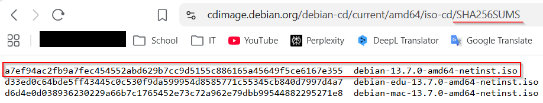


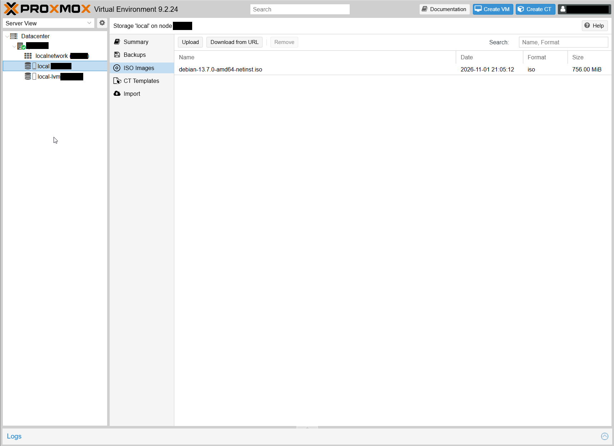

### 4.2 Signature check

The signature check is done on the `SHA256SUMS` file, not on the ISO directly.

1. Download `SHA256SUMS` and `SHA256SUMS.sign`.
2. Import Debian's signing key.
3. Compare the imported key's fingerprint with the fingerprint on Debian's official verification page.
4. Verify the signature with `gpg --verify SHA256SUMS.sign SHA256SUMS` ([GnuPG manual](https://www.gnupg.org/documentation/manuals/gnupg26/gpg.1.html)).
5. Check the ISO's SHA-256 value against the signed `SHA256SUMS` file.
6. Enter the confirmed hash in Proxmox.

The primary key fingerprint shown by GPG matches Debian's official CD signing-key fingerprint (`DF9B 9C49 EAA9 2984 3258 9D76 DA87 E80D 6294 BE9B`) on Debian's verification page ([Debian](https://www.debian.org/CD/verify)).

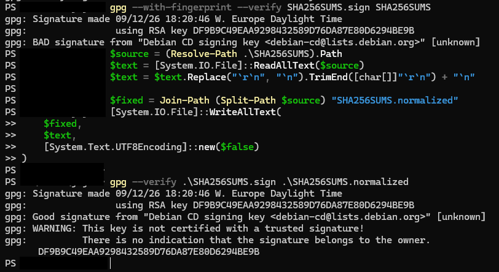

### 4.3 Network checks

**Proxmox in the home network.** I checked in the router interface that the Proxmox server is part of my home network.


The "always assign the same IP" checkbox is not set for the host. That is fine because the address is static and outside the DHCP range.

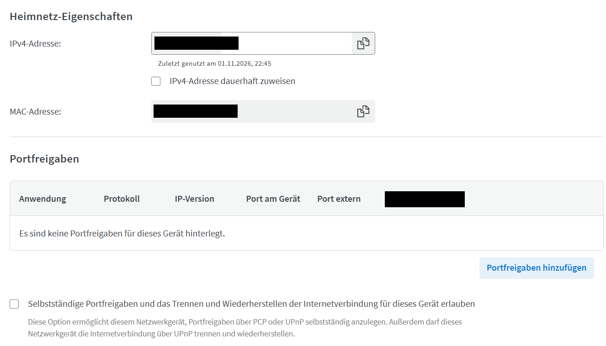

**Static IP confirmed.** First in the Web UI, then in the shell to rule out an address handed out by DHCP:

```bash
cat /etc/network/interfaces
```


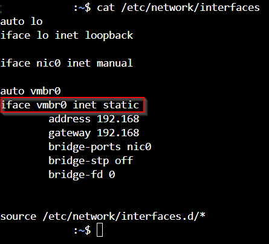

**Switch.** I assigned the switch a static IP outside the DHCP range and disabled DHCP on it.

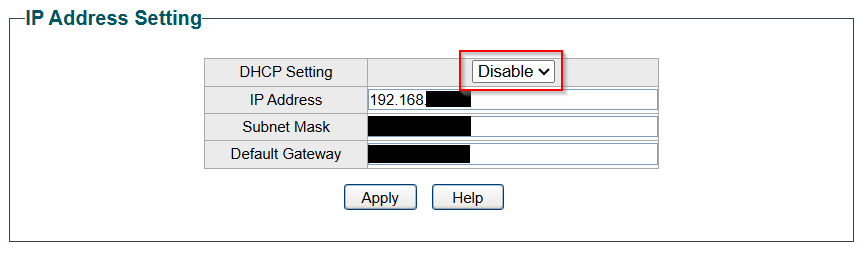

I pinged the new address and received 4/4 replies with 0 % packet loss.

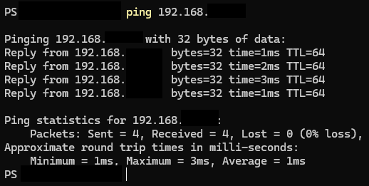

### 4.4 IP plan

I needed an unused IP address outside the DHCP range. First an ARP-based scan of the range:

```bash
sudo nmap -sn -PR 192.168.x.x-x 192.168.x.x-x
```

- `-sn` performs host discovery without a port scan. Nmap's documentation describes host discovery as "ping scanning" ([Nmap Network Scanning](https://nmap.org/book/host-discovery-find-ips.html)).
- `-PR` uses ARP discovery, which fits devices on the same local Ethernet network and is more reliable here than an ordinary ping alone.
- ARP (Address Resolution Protocol) maps an IPv4 address to a MAC address on a local network.
- The scan shows who is online right now, not which addresses are free. It is a cross-check, not proof.

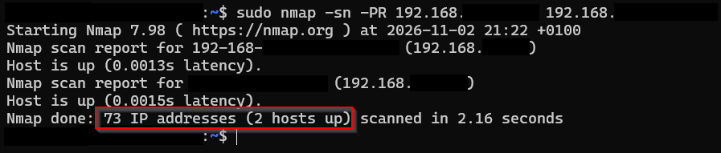

I then chose one address for the LAMP VM and pinged it:

```bash
ping 192.168.x.x -c 4
```

- `-c 4` makes `ping` send exactly 4 echo requests. It does not wait for 4 replies. The screenshot confirms this: 0 replies, yet `ping` stopped after 4 packets ([ping(8) — man7.org](https://man7.org/linux/man-pages/man8/ping.8.html)).
- `Destination Host Unreachable` was not sent by the target. It came from my own host after ARP could not resolve a MAC address, so it indicates that no device answered at that address rather than that the target rejected the ping (own conclusion from the observed ARP behaviour).

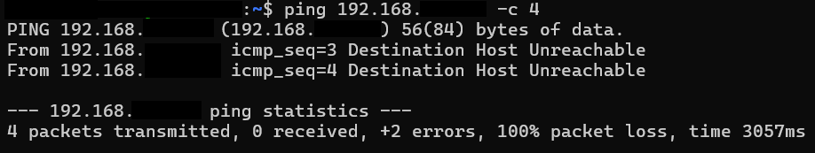

| Device | IP | Static/DHCP | Purpose |
|--------|----|-------------|---------|
| Home router | `<home-subnet>` | static | Gateway, DHCP |
| sw-buero | 192.168.x.x | static | Managed Ethernet switch |
| pve01 | 192.168.x.x | static | Proxmox host |
| LAMP VM | 192.168.x.x | static | host + 1, so related servers sit next to each other and are easy to find |

---

## 5. Verification

| Check | Method | Result |
|-------|--------|--------|
| ISO integrity | Proxmox "Download from URL" with SHA256 checksum | Download finished, ISO listed in the node's storage |
| Signature of `SHA256SUMS` | `gpg --verify SHA256SUMS.sign SHA256SUMS` | "Good signature"; key fingerprint matches Debian's page |
| Proxmox in home network | Router interface | Host listed |
| Proxmox static IP | Web UI and `cat /etc/network/interfaces` | Static configuration confirmed |
| Switch reachable | `ping` to the new address | 4/4 replies, 0 % loss |
| LAMP IP unused | `nmap -sn -PR` and `ping -c 4` | 0 replies; `Destination Host Unreachable` from my own host |

---

## 6. Error log

| Problem | Cause | Fix / lesson |
|---------|-------|--------------|
| `gpg --verify` with a SHA-256 hash | `gpg --verify` expects a signature file and, for a detached signature, the signed data file, not a checksum string ([GnuPG manual](https://www.gnupg.org/documentation/manuals/gnupg26/gpg.1.html)) | Used `SHA256SUMS.sign` together with `SHA256SUMS`. |
| "gpg is not recognized" | GnuPG was not installed | Installed Gpg4win. |
| "No public key" | Debian's signing key was not imported | Imported Debian's signing key. |
| "No such file or directory" | Wrong file names | Corrected the file names. |
| "BAD signature" | I had created the checksum file by copying text from a browser window. The copy had Windows-style CRLF line endings and no final newline. A signature covers the exact bytes. | Restored LF line endings and the final newline: "Good signature". Lesson: keep signed files exactly as downloaded, and treat any "BAD signature" as a failure until the cause is established. |


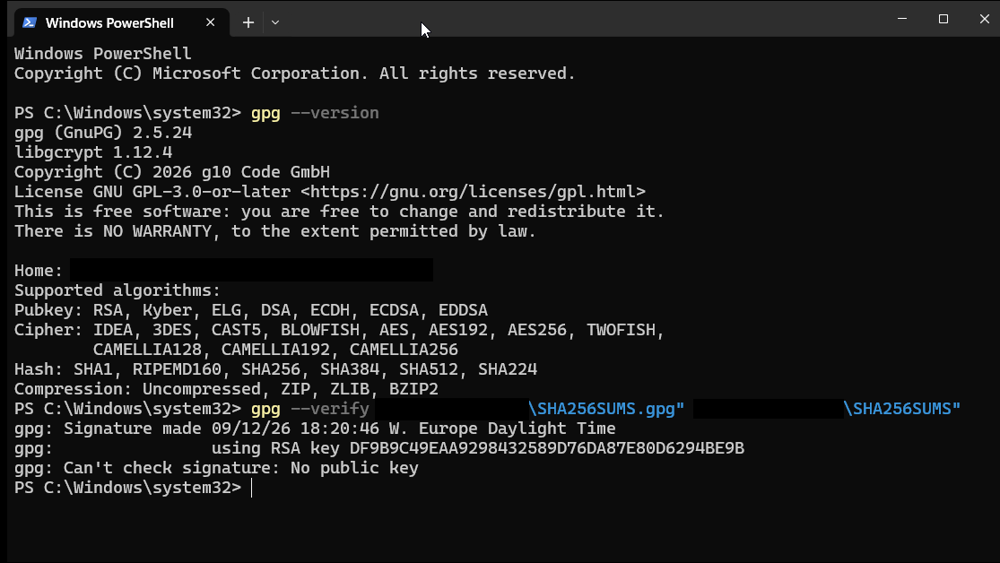

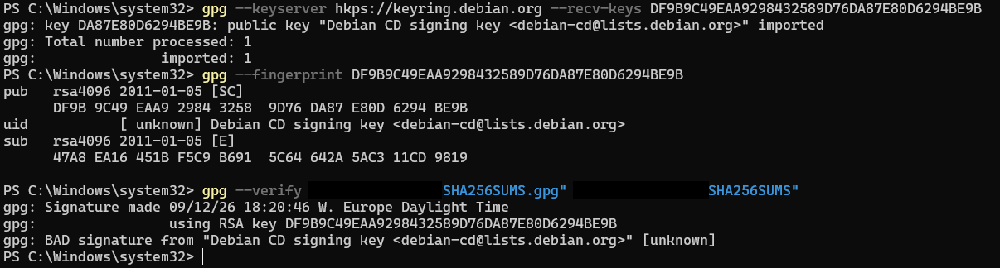

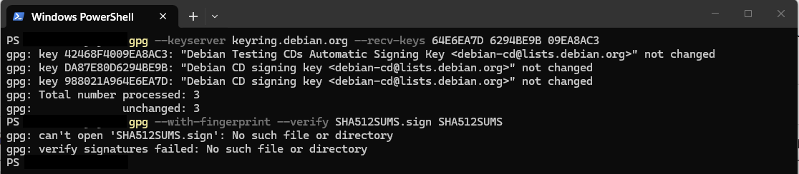


---

## 7. Security notes

- **Checksum (integrity):** a hash such as SHA256 acts as a digital fingerprint of the file. If a single bit of the ISO changes, the checksum changes completely. This shows the download is not corrupted or modified.
- **Signature (authenticity):** a cryptographic signature provided by the developers (a `.sign`, `.gpg` or `.asc` file) shows the file came from the official authors, here Debian, and was not swapped by a third party.
- Together they ensure the file is both intact and authentic. The key fingerprint was compared with Debian's official page, not only taken from the download.
- Static IPs outside the DHCP range avoid address conflicts and do not depend on the router's DHCP server.
- Redaction: see the note at the top of this document.

---

## 8. Open points

- [ ] TODO: align IP visibility between Phase 0 (masked as `192.168.x.x`) and Phase 1 (private addresses shown) and adjust the redaction note

---

## 9. Sources

- [Proxmox VE: Storage - Directory](https://pve.proxmox.com/wiki/Storage:_Directory)
- [Debian: Verifying authenticity of Debian images](https://www.debian.org/CD/verify)
- [Debian Installation Guide: Checking the integrity](https://www.debian.org/releases/stable/amd64/ch04s07.en.html)
- [GnuPG manual: gpg](https://www.gnupg.org/documentation/manuals/gnupg26/gpg.1.html)
- [Nmap: Host discovery](https://nmap.org/book/host-discovery-find-ips.html)
- [ping(8) — man7.org](https://man7.org/linux/man-pages/man8/ping.8.html)
- [Thomas-Krenn: Proxmox upload ISO image](https://www.thomas-krenn.com/en/wiki/Proxmox_upload_ISO_image), [Proxmox VE 7.0 Roadmap](https://pve.proxmox.com/wiki/Roadmap#Proxmox_VE_7.0)
- [Proxmox: Network Configuration](https://pve.proxmox.com/wiki/Network_Configuration), [AVM: Always assign the same IP address](https://fritz.com/apps/knowledge-base/FRITZ-Box-7590/201_Netzwerkgerat-immer-die-gleiche-IP-Adresse-von-FRITZ-Box-zuweisen-lassen)
- [TP-Link Community: TL-SG108E static IP](https://community.tp-link.com/us/smart-home/forum/topic/815912), [AVM: Always assign the same IP address](https://fritz.com/apps/knowledge-base/FRITZ-Box-7590/201_Netzwerkgerat-immer-die-gleiche-IP-Adresse-von-FRITZ-Box-zuweisen-lassen)